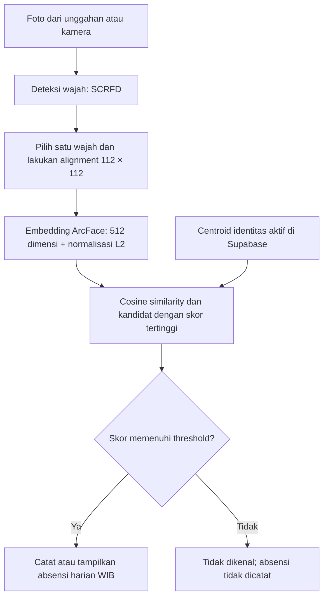

# 👤 Face Recognition Attendance

**Bagaimana mengenali seseorang hanya dari dua foto referensi, sekaligus menolak wajah yang belum terdaftar?**

SCRFD · ArcFace · Centroid · Cosine Similarity · Open-Set Identification

 

[Demo Streamlit](URL_DEMO_STREAMLIT) · [Highlights](#highlights) · [Alur Sistem](#alur-sistem) · [Metode](#metode) · [Hasil](#hasil-evaluasi) · [Dataset](#dataset) · [Setup](SETUP.md)

  

Proyek pengenalan wajah dengan data terbatas yang dikembangkan menjadi **prototipe absensi berbasis Streamlit dan Supabase**. SCRFD menemukan wajah, ArcFace menghasilkan embedding, dan cosine similarity terhadap centroid identitas menentukan kandidat pengenalan. Threshold digunakan untuk menerima kandidat atau menampilkan hasil **tidak dikenal**.

## ✨ Highlights

- **Dua foto untuk pendaftaran.** Setiap identitas diwakili oleh centroid dari dua embedding referensi. Penambahan orang memperbarui galeri tanpa melatih ulang SCRFD atau ArcFace.
- **Data diperiksa sebelum digunakan.** Seluruh 279 foto dari 70 identitas berhasil melalui standardisasi dan alignment; 19 foto dengan beberapa wajah ditinjau manual.
- **Pengenalan sekaligus penolakan unknown.** Pada test open-set dengan galeri 60 identitas, 60/60 foto known dikenali dengan benar dan diterima, serta 20/20 foto unknown ditolak.
- **Eksperimen yang dapat ditelusuri.** Perbandingan nearest template dan centroid, eksperimen satu/dua referensi, serta pengujian ketahanan menggunakan manifest pembagian dan ringkasan metrik.
- **Diterapkan sebagai aplikasi.** Inferensi berjalan pada CPU melalui ONNX Runtime, dengan galeri aktif dan kehadiran harian disimpan di Supabase PostgreSQL.

## 🏗️ Alur Sistem

SCRFD dan ArcFace digunakan sebagai **model pretrained**. Proyek ini mengekstrak fitur, membentuk galeri, dan mengkalibrasi aturan penerimaan; bobot kedua model tidak di-training atau di-fine-tune menggunakan dataset mahasiswa.

## 🧠 Metode

### Deteksi dan alignment

SCRFD mendeteksi lokasi wajah dan lima landmark: dua titik mata, satu titik hidung, dan dua sudut mulut. Landmark digunakan untuk menyelaraskan wajah menjadi crop **112 × 112 piksel** sebelum ekstraksi fitur.

Pada dataset awal, wajah pada foto berisi beberapa orang dipilih melalui review manual. Pada aplikasi absensi, pengguna memilih wajah yang ingin diproses dari hasil deteksi. Setiap foto pendaftaran harus berisi tepat satu wajah.

### Embedding dan centroid

ArcFace menghasilkan **satu vektor berisi 512 angka untuk setiap foto wajah**. Setiap embedding dinormalisasi L2. Dua embedding referensi milik orang yang sama dirata-ratakan, kemudian dinormalisasi kembali menjadi centroid identitas tersebut:

$$
m_i = \frac{e_{i,1} + e_{i,2}}{2}, \qquad
c_i = \frac{m_i}{\lVert m_i \rVert_2}
$$

Setiap orang memiliki satu centroid berdimensi 512, beserta dua embedding referensinya. Galeri aplikasi menggunakan metode centroid; nearest template digunakan sebagai pembanding dalam eksperimen.

### Pencocokan dan penolakan unknown

Embedding foto masukan dibandingkan dengan seluruh centroid aktif menggunakan cosine similarity:

$$
s_i = \frac{q \cdot c_i}{\lVert q \rVert_2\lVert c_i \rVert_2}
$$

Karena kedua vektor telah dinormalisasi, perhitungan menyederhana menjadi dot product. Identitas dengan skor tertinggi menjadi kandidat dan diterima hanya jika skornya memenuhi threshold. **Skor kemiripan bukan probabilitas kebenaran identitas.**

<b>Bagaimana threshold 0,472245 dipilih?</b>

Kalibrasi menggunakan galeri 60 identitas, 59 foto validation known, dan 20 foto validation unknown. Untuk setiap foto validasi, sistem mengambil skor tertinggi terhadap seluruh centroid.

Kode membentuk kandidat threshold dari titik tengah antar-skor unik, ditambah batas di luar skor minimum dan maksimum. Pemilihannya berurutan:

1. Hanya pertimbangkan kandidat dengan nol unknown yang diterima pada validasi.
2. Maksimalkan jumlah known yang dikenali dengan benar dan diterima.
3. Jika setara, pilih celah antar-skor terlebar; jika masih setara, pilih threshold lebih rendah.

Pada validasi ini, skor unknown tertinggi sekitar **0,3558**, sedangkan skor known terendah sekitar **0,5887**; seluruh kandidat known benar. Titik tengah celah pemisah tersebut, dihitung dari skor lengkap sebelum pembulatan, menghasilkan threshold **0,47224538**.

Threshold kemudian dibekukan dan digunakan pada test terpisah. Nilai ini dikalibrasi pada galeri 60 identitas dan berstatus **provisional** saat digunakan untuk galeri 70 identitas atau galeri aplikasi yang berubah.

## 📊 Hasil Evaluasi

Hasil berikut berasal dari output eksperimen yang tersimpan di notebook. Setiap hasil memiliki protokol dan ruang lingkupnya sendiri.

### Perbandingan metode dan jumlah referensi

| Protokol | Nearest template | Centroid |
|---|---:|---:|
| Leave-one-image-out, 279 foto uji bergantian | 279/279 benar | 279/279 benar |
| Satu referensi, 30 pembagian acak | Rata-rata akurasi 100% | Rata-rata akurasi 100% |
| Dua referensi, 30 pembagian acak | Rata-rata akurasi 100% | Rata-rata akurasi 100% |

Foto uji dikeluarkan dari galeri pada setiap evaluasi. Pada eksperimen few-shot, setiap pembagian menggunakan satu foto uji per identitas dan pilihan foto referensi yang diacak. Pembagian berulang menggunakan dataset yang sama; hasilnya bukan pengujian terhadap identitas atau sesi pengambilan gambar baru.

### Ketahanan terhadap perubahan kualitas gambar

Rata-rata akurasi pada 30 pembagian acak, dibulatkan. Kedua metode menghasilkan nilai yang sama pada ringkasan berikut:

| Kondisi foto uji | Satu referensi | Dua referensi |
|---|---:|---:|
| Normal | 100% | 100% |
| Kecerahan × 0,5 | 100% | 100% |
| Kecerahan × 1,5 | 100% | 100% |
| Gaussian blur radius 1 | 100% | 100% |
| Gaussian blur radius 2 | ≈99,90% | ≈99,95% |

Pada blur radius 2, dua referensi lebih baik pada **1 dari 30 pembagian** dan setara pada 29 pembagian lainnya, dengan kenaikan rata-rata sekitar **0,0476 poin persentase**. Eksperimen ini belum menunjukkan keunggulan akurasi centroid atas nearest template.

Perubahan dilakukan pada **foto yang sudah di-alignment**, sementara galeri tetap memakai embedding kondisi normal. Pengujian mengukur ketahanan ekstraksi fitur dan pencocokan tanpa menerapkan threshold open-set; belum mengukur kemampuan deteksi pada foto mentah yang gelap atau blur.

### Validasi dan test open-set

Galeri evaluasi berisi **60 identitas × 2 foto referensi**. Lima identitas unknown validasi berbeda dari lima identitas unknown test dan seluruhnya berada di luar galeri. Threshold **0,47224538** dipilih pada validasi, kemudian digunakan tanpa perubahan pada test.

| Hasil | Validasi untuk kalibrasi | Test terpisah |
|---|---:|---:|
| Known benar dan diterima | 59/59 | **60/60** |
| Known ditolak | 0 | 0 |
| Known diterima dengan identitas salah | 0 | 0 |
| Unknown berhasil ditolak | 20/20 | **20/20** |
| Unknown salah diterima | 0/20 | **0/20** |

*Known* berarti identitas terdaftar di galeri evaluasi; *unknown* berarti identitas tidak ada di galeri tersebut. Satu identitas hanya memiliki tiga foto, sehingga memperoleh dua foto galeri dan satu foto test, tanpa foto validation known.

Hasil test ini berlaku untuk **80 foto pada protokol galeri 60 identitas tersebut**. Hasilnya belum membuktikan performa yang sama pada seluruh pengguna, kondisi kamera, wajah sangat mirip, atau galeri yang lebih besar. Nol kesalahan teramati juga tidak berarti risiko kesalahan di penggunaan nyata adalah nol.

## 🗂️ Dataset dan Privasi

Dataset berasal dari **mahasiswa yang mengikuti perkuliahan Deep Learning pada Program Studi Teknik Informatika, Institut Teknologi Sumatera (ITERA), tahun 2025**.

| Karakteristik dataset awal | Jumlah |
|---|---:|
| Identitas | 70 |
| Foto | 279 |
| Identitas dengan empat foto | 69 |
| Identitas dengan tiga foto | 1 |
| Foto dengan beberapa wajah yang ditinjau manual | 19 |
| Foto berhasil distandardisasi dan di-alignment | 279 |

Audit mencakup keterbacaan, format sebenarnya, orientasi EXIF, dan duplikasi piksel. Sebanyak 17 file MPO memiliki 42 frame yang dapat dibaca; standardisasi menggunakan frame pertama sehingga jumlah sampel tetap 279. Tidak ditemukan duplikat dengan isi piksel identik pada audit tersebut.

**Dataset tidak dipublikasikan untuk menjaga privasi mahasiswa.** Foto wajah, nama peserta, embedding per individu, dan laporan yang mengandung data pribadi tidak disertakan dalam repository publik. Embedding wajah tetap diperlakukan sebagai data sensitif.

Jumlah 70 identitas menggambarkan dataset eksperimen awal. Jumlah identitas aktif pada aplikasi dapat berubah melalui pendaftaran dan pengelolaan data. Reproduksi penuh eksperimen memerlukan dataset privat dan artefak sumber yang tidak disertakan dalam repository.

## 🖥️ Fitur Aplikasi

| Fitur | Perilaku |
|---|---|
| Unggahan atau kamera | Menyediakan foto untuk pengenalan wajah |
| Pemilihan wajah | Memproses wajah pilihan pada foto yang berisi beberapa orang |
| Pendaftaran identitas | Nama lengkap dan dua foto berbeda, masing-masing dengan tepat satu wajah |
| Pemeriksaan duplikat | Peringatan jika wajah pendaftaran terindikasi sudah terdaftar |
| Galeri dinamis | Identitas aktif dibaca dari Supabase saat pencocokan |
| Penolakan unknown | Absensi tidak dicatat jika skor terbaik di bawah threshold |
| Kehadiran harian | Maksimal satu catatan per identitas per tanggal WIB / Asia/Jakarta |

Pendaftaran langsung aktif tanpa persetujuan admin. Pendaftar diminta menggunakan dua foto dirinya sendiri. Pemeriksaan jumlah wajah dan kemiripan belum membuktikan kepemilikan identitas atau memastikan dua foto berasal dari orang yang sama.

<b>Alur notebook eksperimen</b>

Notebook eksperimen dijalankan secara lokal dan tidak disertakan dalam repository publik karena outputnya dapat memuat data pribadi.

| Notebook lokal | Isi utama |
|---|---|
| `01_data_audit.ipynb` | Audit file, standardisasi, deteksi, review wajah, crop dan alignment |
| `02_model_comparison(2).ipynb` | Ekstraksi embedding, nearest template vs centroid, few-shot, dan robustness |
| `03_open_set_evaluation.ipynb` | Pembagian galeri/validasi/test, kalibrasi threshold, dan evaluasi open-set |
| `04_app_preparation.ipynb` | Galeri awal 70 identitas dan konfigurasi inferensi |

Manifest menyimpan pembagian foto dan hubungan antartahap. Hash SHA-256 digunakan untuk memeriksa konsistensi artefak galeri, embedding, dan pembagian data saat evaluasi.

## 🧰 Teknologi

| Bagian | Teknologi |
|---|---|
| Deteksi wajah | SCRFD — `det_10g.onnx` |
| Ekstraksi fitur | ArcFace — `w600k_r50.onnx` |
| Inferensi CPU | InsightFace 0.7.3, ONNX Runtime |
| Pengolahan dan evaluasi | OpenCV, Pillow, NumPy, Pandas, scikit-learn |
| Antarmuka | Streamlit |
| Database | Supabase PostgreSQL |
| Akses database | SQLAlchemy, Psycopg |
| Deployment | Streamlit Community Cloud |

## 🔭 Batasan dan Pengembangan

Proyek merupakan **prototipe pembelajaran dan penelitian nonkomersial**. Pengenalan wajah saja belum membuktikan kehadiran fisik: sistem belum memiliki liveness detection atau anti-spoofing khusus terhadap foto dan layar.

Prioritas pengembangan:

- Kalibrasi dan pengujian ulang pada galeri lebih besar, kondisi kamera nyata, serta lebih banyak identitas unknown.
- Evaluasi wajah sangat mirip, termasuk kembar, dan aturan penanganan kandidat dengan skor berdekatan.
- Pemeriksaan kualitas wajah dan konsistensi dua foto pendaftaran.
- Pembatasan frekuensi permintaan, kapasitas galeri, dan dimensi gambar.
- Liveness detection, pengelolaan identitas, monitoring, dan backup.
- Rekap kehadiran serta ekspor laporan sesuai kebutuhan berikutnya.

## 📖 Dokumentasi Teknis

Panduan instalasi, konfigurasi Supabase, pengelolaan Secrets, penyediaan model, dan deployment tersedia terpisah di **[SETUP.md](SETUP.md)**. Untuk mencoba aplikasi, gunakan **[demo Streamlit](URL_DEMO_STREAMLIT)**.

## 📚 Referensi dan Lisensi Model

- [InsightFace Python Library 0.7.3 — dokumentasi dan lisensi](https://pypi.org/project/insightface/0.7.3/)
- [SCRFD: Sample and Computation Redistribution for Efficient Face Detection](https://arxiv.org/abs/2105.04714)
- [ArcFace: Additive Angular Margin Loss for Deep Face Recognition](https://arxiv.org/abs/1801.07698)
- [Koneksi PostgreSQL Supabase](https://supabase.com/docs/guides/database/connecting-to-postgres)
- [Deployment Streamlit Community Cloud](https://docs.streamlit.io/deploy/streamlit-community-cloud/deploy-your-app/deploy)

Kode **InsightFace Python Library** dirilis dengan lisensi **MIT**. Pretrained model yang disediakan bersama library, termasuk model yang diunduh otomatis maupun manual, memiliki ketentuan penggunaan **penelitian nonkomersial** sebagaimana dijelaskan pada dokumentasi InsightFace 0.7.3.

Lisensi kode library dan ketentuan bobot model adalah dua hal berbeda. Penggunaan lebih lanjut harus mengikuti ketentuan masing-masing komponen; repository ini tidak memberikan lisensi tambahan atas model pihak ketiga.
