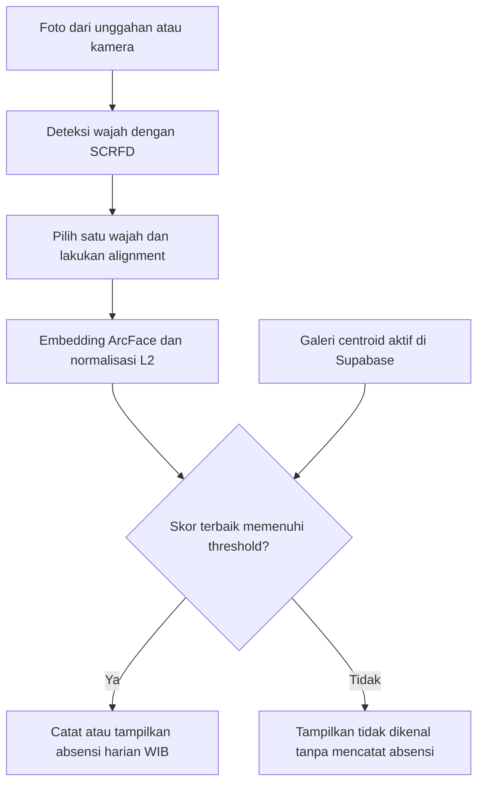

# Face Recognition Attendance

Proyek pengenalan wajah dengan data terbatas yang dikembangkan menjadi **prototipe absensi berbasis Streamlit dan Supabase**. Sistem menggunakan **SCRFD** untuk mendeteksi wajah, **ArcFace** untuk menghasilkan embedding, dan **cosine similarity terhadap centroid identitas** untuk menentukan hasil pengenalan.

[Demo Streamlit](URL_DEMO_STREAMLIT) · [Panduan setup dan konfigurasi](SETUP.md)

## Gambaran Proyek

Proyek ini berangkat dari kondisi ketika setiap orang hanya memiliki beberapa foto referensi. Pendekatan yang digunakan adalah memanfaatkan model pengenal wajah pretrained sebagai pengekstrak fitur, kemudian membandingkan representasi wajah tersebut dengan galeri identitas.

Pengembangan mencakup audit dataset, pemilihan wajah pada foto, crop dan alignment, ekstraksi embedding, eksperimen pencocokan, pemilihan threshold, serta integrasi ke aplikasi absensi. Inferensi berjalan menggunakan **CPU melalui ONNX Runtime**.

Penambahan identitas memperbarui galeri di database. Proses tersebut **tidak melatih ulang bobot SCRFD atau ArcFace**.

## Dataset

Dataset berasal dari **mahasiswa yang mengikuti perkuliahan Deep Learning pada Program Studi Teknik Informatika, Institut Teknologi Sumatera (ITERA), tahun 2025**.

| Karakteristik dataset awal | Jumlah |
|---|---:|
| Identitas | 70 |
| Foto | 279 |
| Identitas dengan empat foto | 69 |
| Identitas dengan tiga foto | 1 |
| Foto dengan beberapa wajah yang ditinjau manual | 19 |
| Foto berhasil melalui standardisasi dan alignment | 279 |

**Dataset tidak dipublikasikan untuk menjaga privasi mahasiswa.** Foto wajah, nama peserta, embedding per individu, dan laporan yang mengandung data pribadi tidak disertakan dalam repository publik. Dokumentasi menyajikan metode dan ringkasan hasil tanpa membagikan dataset tersebut.

Angka 70 identitas menggambarkan dataset eksperimen awal. Jumlah identitas pada aplikasi dapat berubah melalui pendaftaran atau pengelolaan data.

## Konsep dan Pendekatan

### 1. Pengenalan dengan sedikit referensi

Proyek menggunakan pendekatan **few-shot face identification**. Galeri aplikasi menyimpan dua embedding referensi untuk setiap identitas. Model pretrained menghasilkan representasi wajah yang kemudian digunakan untuk pencocokan, sehingga tidak diperlukan pelatihan model klasifikasi baru untuk setiap penambahan orang.

### 2. Deteksi dan pemilihan wajah dengan SCRFD

SCRFD mendeteksi lokasi wajah dan lima titik landmark. Foto absensi boleh berisi beberapa wajah; pengguna memilih nomor wajah yang akan diproses. Sebaliknya, setiap foto pendaftaran harus berisi tepat satu wajah.

Pada persiapan dataset awal, foto yang mengandung beberapa wajah ditinjau manual agar wajah yang dipilih sesuai dengan identitas pemilik foto.

### 3. Alignment wajah

Landmark digunakan untuk menyelaraskan posisi wajah sebelum ekstraksi fitur. Hasilnya berupa crop berukuran **112 × 112 piksel**. Alignment membantu membuat posisi wajah lebih konsisten antara foto referensi dan foto masukan.

### 4. Embedding ArcFace dan normalisasi L2

ArcFace menghasilkan embedding **512 dimensi** untuk merepresentasikan karakteristik wajah. Embedding dinormalisasi dengan norma L2 agar pencocokan berfokus pada arah vektor.

Bobot model tetap digunakan sebagai pretrained feature extractor; proyek ini tidak melakukan fine-tuning ArcFace pada dataset mahasiswa.

### 5. Centroid dan cosine similarity

Dua embedding referensi suatu identitas dirata-ratakan, kemudian hasilnya dinormalisasi kembali menjadi satu centroid:

$$
c_i = \frac{e_{i,1} + e_{i,2}}{\left\|e_{i,1} + e_{i,2}\right\|_2}
$$

Embedding foto masukan dibandingkan dengan seluruh centroid aktif. Karena vektor telah dinormalisasi, cosine similarity dapat dihitung melalui dot product. Identitas dengan skor tertinggi menjadi kandidat hasil pengenalan.

**Skor kemiripan bukan probabilitas bahwa identitas tersebut benar.**

### 6. Open-set identification

Sistem tidak selalu memaksakan foto masukan menjadi salah satu identitas terdaftar. Kandidat diterima hanya jika skor terbaik memenuhi threshold; jika tidak, hasil ditampilkan sebagai **tidak dikenal** dan absensi tidak dicatat.

Pendekatan ini merupakan open-set identification: pengguna yang belum terdaftar juga mungkin muncul pada foto masukan.

### 7. Galeri dinamis dan absensi harian

Identitas, embedding referensi, dan centroid disimpan di **Supabase PostgreSQL**. Galeri aktif dibaca saat pencocokan sehingga pendaftaran baru dapat digunakan tanpa melatih ulang model.

Pencatatan menggunakan aturan unik per identitas dan tanggal **WIB / Asia/Jakarta**. Absensi berulang pada tanggal yang sama menampilkan catatan pertama tanpa membuat catatan kehadiran tambahan.

## Alur Sistem

## Fitur Aplikasi

| Fitur | Perilaku |
|---|---|
| Unggahan foto atau kamera | Menyediakan foto masukan untuk pengenalan |
| Pemilihan wajah | Memproses wajah yang dipilih dari foto berisi beberapa orang |
| Pendaftaran identitas | Menerima nama lengkap dan dua foto berbeda, masing-masing dengan satu wajah |
| Pemeriksaan duplikat | Menampilkan peringatan ketika wajah pendaftaran terindikasi sudah ada |
| Penolakan unknown | Tidak mencatat absensi jika skor di bawah threshold |
| Absensi harian | Menyimpan maksimal satu catatan per identitas per tanggal WIB |
| Galeri dinamis | Menggunakan identitas aktif yang tersimpan di database |

Pendaftaran langsung aktif tanpa persetujuan admin. Pendaftar diminta menggunakan dua foto dirinya sendiri. Pemeriksaan jumlah wajah dan duplikat belum merupakan pembuktian bahwa pengunggah adalah pemilik identitas tersebut.

## Tahap Pengembangan dan Evaluasi

Persiapan data mencakup pemeriksaan keterbacaan dan duplikat file, standardisasi RGB dan orientasi EXIF, pemilihan frame utama untuk MPO, deteksi wajah, review manual, crop dan alignment, serta pemeriksaan normalisasi embedding.

Eksperimen pengembangan mencakup perbandingan pencocokan berbasis template dan centroid, jumlah referensi satu atau dua foto, serta ketahanan terhadap perubahan kualitas gambar. Evaluasi open-set digunakan untuk mempelajari pemisahan skor wajah terdaftar dan wajah di luar galeri.

### Threshold dan hasil validasi

Threshold pada konfigurasi awal adalah **0,472245**. Nilai tersebut dipilih menggunakan data validasi dengan galeri **60 identitas**.

| Hasil pada tahap pemilihan threshold | Jumlah |
|---|---:|
| Foto known dikenali dengan identitas benar dan diterima | 59 / 59 |
| Foto known ditolak | 0 |
| Foto known diterima dengan identitas salah | 0 |
| Foto unknown salah diterima | 0 / 20 |

*Known* berarti identitas terdaftar di galeri evaluasi; *unknown* berarti identitas berada di luar galeri tersebut.

Hasil ini merupakan **hasil validasi untuk pemilihan threshold**, bukan estimasi performa independen pada seluruh pengguna aplikasi. Ketika galeri diperluas atau berubah, threshold masih bersifat sementara dan perlu dikalibrasi serta diuji ulang. Hasil pada dataset kecil juga belum mewakili semua kondisi kamera, pencahayaan, pose, atau pengguna baru.

## Teknologi

| Bagian | Teknologi |
|---|---|
| Deteksi wajah | SCRFD — `det_10g.onnx` |
| Representasi wajah | ArcFace — `w600k_r50.onnx` |
| Inferensi CPU | InsightFace 0.7.3 dan ONNX Runtime |
| Pengolahan gambar | OpenCV, Pillow, NumPy |
| UI | Streamlit |
| Penyimpanan | Supabase PostgreSQL |
| Akses database | SQLAlchemy dan Psycopg |
| Deployment | Streamlit Community Cloud |

## Batasan dan Pengembangan Berikutnya

Proyek ini merupakan prototipe pembelajaran dan penelitian nonkomersial. Sistem belum memiliki liveness detection atau pemeriksaan anti-spoofing khusus untuk menolak penggunaan foto dan layar. Pengenalan wajah saja belum membuktikan kehadiran fisik seseorang.

Pengembangan berikutnya meliputi:

- Pembatasan frekuensi permintaan, kapasitas galeri, dan validasi dimensi gambar.
- Kalibrasi ulang threshold dengan lebih banyak identitas unknown dan kondisi kamera.
- Pemeriksaan konsistensi dua foto pendaftaran serta kualitas wajah.
- Liveness detection dan evaluasi terhadap upaya pemalsuan kehadiran.
- Pengelolaan identitas, monitoring, backup, dan alur bootstrap galeri baru.
- Rekap kehadiran dan ekspor laporan sesuai kebutuhan penggunaan berikutnya.

## Dokumentasi Teknis

Petunjuk instalasi, konfigurasi Supabase, pengelolaan Secrets, penyediaan model, pengujian, dan deployment tersedia pada **[SETUP.md](SETUP.md)**.

## Referensi dan Lisensi Model

- [InsightFace Python Library 0.7.3 — dokumentasi dan lisensi](https://pypi.org/project/insightface/0.7.3/)
- [SCRFD: Sample and Computation Redistribution for Efficient Face Detection](https://arxiv.org/abs/2105.04714)
- [ArcFace: Additive Angular Margin Loss for Deep Face Recognition](https://arxiv.org/abs/1801.07698)
- [Koneksi PostgreSQL Supabase](https://supabase.com/docs/guides/database/connecting-to-postgres)
- [Deployment Streamlit Community Cloud](https://docs.streamlit.io/deploy/streamlit-community-cloud/deploy-your-app/deploy)

Kode library InsightFace menggunakan lisensi **MIT**, sedangkan pretrained model yang disediakan pada distribusi tersebut memiliki ketentuan penggunaan **penelitian nonkomersial**. Ketentuan kode library dan bobot model berbeda. Penggunaan lebih lanjut perlu mengikuti lisensi masing-masing komponen; proyek ini tidak memberikan lisensi tambahan atas model pihak ketiga.
