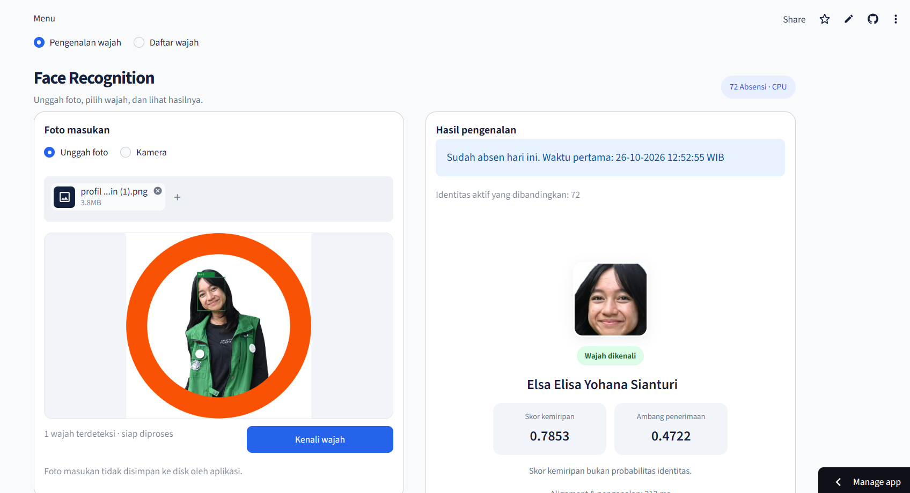

# Panduan Setup dan Konfigurasi

Dokumen teknis untuk **[Face Recognition Attendance](README.md)**. Gambaran proyek, asal dataset, konsep, dan hasil validasi tersedia pada README utama.

Panduan ini tidak menyertakan dataset privat mahasiswa ITERA. Menjalankan aplikasi memerlukan database dan galeri aktif yang disiapkan menggunakan data yang berhak digunakan oleh pengelola.

## Susunan File Utama

| File | Fungsi |
|---|---|
| `streamlit_app.py` | Antarmuka pengenalan dan absensi |
| `src/face_pipeline.py` | Deteksi, alignment, ekstraksi embedding, dan pencocokan |
| `src/attendance_service.py` | Validasi pendaftaran, pemeriksaan duplikat, dan pencatatan absensi |
| `src/registration_page.py` | Antarmuka pendaftaran dua foto |
| `src/database.py` | Koneksi Supabase dan pengaturan sesi database |
| `src/model_files.py` | Penyediaan model dan verifikasi SHA256 |
| `artifacts/inference_config.json` | Parameter inferensi dan metadata eksperimen awal |
| `certs/supabase-ca.crt` | Sertifikat CA untuk verifikasi koneksi database |
| `.streamlit/config.toml` | Tema, batas unggahan, dan pengaturan tampilan error |
| `requirements.txt` | Dependensi aplikasi |

Folder data privat, backup, bobot ONNX, dan script pemeriksaan lokal dikecualikan melalui `.gitignore`. Field galeri eksperimen pada konfigurasi dapat tetap tersedia sebagai metadata; alur aplikasi yang telah diperbarui membaca galeri aktif dari Supabase.

## Reproduksi Eksperimen dengan Dataset Sendiri

Ada dua alur yang berbeda:

| Tujuan | Kebutuhan |
|---|---|
| Menjalankan aplikasi absensi | Kode aplikasi, model ONNX, konfigurasi, serta Supabase yang sudah berisi galeri aktif |
| Mengulang workflow penelitian | Notebook publik, dependensi penelitian, dan dataset sendiri; Supabase tidak diperlukan untuk menjalankan notebook |

Notebook asli di `notebooks/` tetap privat. Versi kode publik ada di **[notebooks_public/](notebooks_public/README.md)**, tanpa output cell, foto, nama peserta, metadata sesi, atau path pribadi penulis. Kode pratinjau tetap tersedia untuk review lokal; menjalankannya pada dataset pribadi dapat menghasilkan output sensitif lagi.

Pasang dependensi tambahan pada environment proyek:

```bash
python -m pip install -r requirements-research.txt
python -m jupyter lab
```

Gunakan struktur `dataset/raw/<label_orang>/<foto>`, dengan 3–4 foto berbeda per identitas untuk protokol notebook ini. Label pseudonim disarankan. Jalankan notebook 01 sampai 04 secara berurutan. Notebook 01 memiliki checkpoint review manual untuk foto berisi beberapa wajah, sehingga memerlukan interaksi; sel pemilihan wajah tidak dijalankan otomatis.

Notebook 03 menggunakan default lima identitas unknown validasi dan lima unknown test, dengan sisanya sebagai known. Default membutuhkan minimal 12 identitas. Sesuaikan parameter untuk dataset sendiri; seluruh identitas unknown harus berada di luar galeri dan kelompok unknown validasi/test harus berbeda. Foto galeri, validasi, dan test juga dipisahkan sesuai manifest.

Notebook publik diturunkan dari eksperimen asli, dengan urutan dibersihkan, path relatif, jumlah identitas/foto dinamis, dan hasil galeri bernama sesuai jumlah identitas. Pembagian 30 seed, metode pencocokan, transformasi robustness, dan kebijakan pemilihan threshold tetap mengikuti eksperimen asli. Kode telah diperiksa sintaksnya dan bagian split/kalibrasi/ekspor diuji memakai embedding sintetis; belum dijalankan ulang end-to-end dengan dataset wajah asli atau model ONNX dalam revisi dokumentasi ini.

**Yang dapat diulang:** alur pengolahan, ekstraksi fitur, protokol evaluasi, dan kalibrasi pada data milik sendiri. **Yang tidak dapat dijamin sama:** angka hasil eksperimen awal, threshold 0,472245, dan galeri mahasiswa, karena dataset asli tidak dibagikan. Hash bertujuan memeriksa konsistensi artefak lokal, bukan membuat dataset privat dapat direkonstruksi.

Notebook 04 menulis galeri dan `artifacts/inference_config.json` secara lokal. Gunakan checkout eksperimen terpisah jika tidak ingin mengubah artefak aplikasi yang sedang digunakan. Artefak tersebut tetap privat dan tidak perlu dipush. Notebook ini **tidak mengisi Supabase secara otomatis**. Keterbatasan bootstrap galeri kosong dan asumsi 70 identitas pada importer awal tetap berlaku; konfigurasi jumlah identitas dinamis pada notebook tidak mengubah batas importer tersebut.

Sebelum membagikan notebook yang pernah dijalankan, bersihkan salinan publik:

```bash
python scripts/clear_notebook_outputs.py
```

Script hanya membersihkan `notebooks_public/`, bukan notebook asli. Tinjau juga source code, teks Markdown, screenshot, diff Git, dan file yang akan di-commit. Menghapus output tidak otomatis menghapus data yang ditulis langsung di source atau riwayat Git.

## Menjalankan Secara Lokal

### 1. Prasyarat

- Python **3.11** untuk mengikuti konfigurasi deployment yang disarankan.
- Proyek Supabase dengan tiga tabel, role aplikasi, dan kebijakan akses yang sudah disiapkan.
- Galeri dengan sedikitnya satu identitas aktif yang memiliki centroid valid. Loader saat ini menolak galeri kosong; bootstrap database baru memerlukan penyiapan galeri awal secara terpisah.
- Sertifikat CA yang sesuai untuk koneksi Supabase.

Repository tidak menyertakan foto, embedding peserta, atau kredensial database. Panduan ini mengasumsikan database sudah diinisialisasi menggunakan data yang berhak digunakan oleh pengelola aplikasi.

### 2. Clone dan pasang dependensi

```bash
git clone https://github.com/elsaelisa09/face-recognition-attendance.git
cd face-recognition-attendance
python -m venv .venv
```

Aktifkan environment pada Windows PowerShell:

```powershell
.\.venv\Scripts\Activate.ps1
```

Atau pada Linux/macOS:

```bash
source .venv/bin/activate
```

Pasang dependensi:

```bash
python -m pip install -r requirements.txt
```

InsightFace dan dependensinya dapat memerlukan proses build sesuai sistem operasi. File requirements menetapkan batas versi, bukan lock file lengkap untuk seluruh dependensi transitif.

### 3. Konfigurasi database

Buat file `.streamlit/secrets.toml` secara lokal:

```toml
[database_supabase]
host = "HOST_SESSION_POOLER"
port = 5432
name = "postgres"
username = "face_attendance_app.PROJECT_REF"
password = "PASSWORD_AKUN_APLIKASI"
sslmode = "verify-full"
sslrootcert = "certs/supabase-ca.crt"
```

Ganti placeholder menggunakan pengaturan proyek sendiri. Gunakan sertifikat CA yang sesuai pada lokasi `certs/supabase-ca.crt` dan akun database khusus aplikasi. Simpan password di Secrets; file `secrets.toml` tidak boleh di-commit.

Koneksi aplikasi menetapkan `extra_float_digits = 3` agar pembacaan vektor PostgreSQL tidak kehilangan presisi akibat format keluaran angka.

### 4. Jalankan aplikasi

```bash
python -m streamlit run streamlit_app.py
```

Ketika model belum tersedia atau hash file tidak cocok, aplikasi mencoba mengunduh paket `buffalo_l`, mengambil dua model yang diperlukan, dan memverifikasi SHA256 sebelum menyimpannya. Koneksi internet diperlukan untuk pengunduhan awal; model yang tersedia dan cocok akan digunakan kembali.

## Skema Database

| Tabel | Data utama | Aturan |
|---|---|---|
| `persons` | ID, nama lengkap, centroid, status aktif | Centroid berupa vektor 512 dimensi |
| `face_references` | ID pemilik, nomor referensi, embedding, ID sumber | Dua slot referensi per identitas: nomor 1 dan 2 |
| `attendance` | ID pemilik, waktu, tanggal WIB, similarity, threshold | Unik pada pasangan `person_id` dan `attendance_date` |

`face_references` terhubung ke `persons` melalui foreign key dengan penghapusan berantai. Relasi `attendance` membatasi penghapusan identitas yang masih memiliki catatan absensi. Penghapusan permanen merupakan operasi administrasi database, bukan fitur pendaftaran publik.

Waktu disimpan sebagai `TIMESTAMPTZ`. Kolom tanggal absensi diturunkan menggunakan zona waktu **Asia/Jakarta**, sehingga aturan absensi harian mengikuti WIB.

## Persiapan Akses Supabase

1. Siapkan tabel sesuai skema di atas menggunakan role administrasi melalui SQL Editor Supabase. DDL tabel awal dapat dilihat pada `src/database.py`.
2. Buat role login khusus aplikasi bernama `face_attendance_app`, tanpa hak superuser, pembuatan database, pembuatan role, atau bypass RLS.
3. Berikan akses `CONNECT` ke database, `USAGE` schema dan sequence yang diperlukan, serta akses baca dan tambah pada ketiga tabel.
4. Aktifkan RLS dan buat kebijakan yang secara khusus mengizinkan operasi runtime role aplikasi.
5. Kode saat ini memakai `LOCK TABLE ... IN SHARE ROW EXCLUSIVE MODE` saat pendaftaran dan `SELECT ... FOR SHARE` saat absensi. Role memerlukan izin `UPDATE` pada `persons` untuk operasi penguncian tersebut. Kebijakan `FOR UPDATE` menggunakan `USING (TRUE)` dan `WITH CHECK (FALSE)` untuk memungkinkan penguncian sambil menolak penyimpanan perubahan baris melalui `UPDATE`.
6. Cabut akses umum yang tidak diperlukan dari tabel dan sequence aplikasi. Jika proyek hanya digunakan melalui koneksi SQL server Python, nonaktifkan Data API di pengaturan Supabase.

DDL, pemberian hak, penghapusan data, dan operasi administrasi dijalankan menggunakan role administrasi. Akun runtime digunakan untuk fitur aplikasi sesuai hak dan kebijakannya, bukan untuk inisialisasi schema.

Untuk koneksi IPv4 pada deployment ini, gunakan **Session pooler**, port **5432**, dengan username `face_attendance_app.PROJECT_REF`. Salin host dari panel **Connect** Supabase. Verifikasi koneksi menggunakan `sslmode=verify-full` dan sertifikat CA yang sesuai.

**Bootstrap galeri:** loader saat ini menolak database tanpa identitas aktif. Repository tidak menyertakan foto atau embedding untuk mengisi galeri. Proses penyiapan data awal harus dilakukan secara terpisah. Script `scripts/import_initial_gallery.py` ditujukan untuk format artefak eksperimen awal 70 identitas dan memerlukan NPZ serta hash konfigurasi yang sesuai; script itu bukan alur bootstrap umum atau sinkronisasi rutin database produksi.

## Konfigurasi Server Streamlit

Gunakan `.streamlit/config.toml` berikut:

```toml
[theme]
primaryColor = "#2563EB"
backgroundColor = "#F8FAFC"
secondaryBackgroundColor = "#EEF2F7"
textColor = "#14213D"
font = "sans serif"

[server]
maxUploadSize = 5
enableCORS = true
enableXsrfProtection = true
enableStaticServing = false

[client]
showErrorDetails = "none"
```

`maxUploadSize = 5` membatasi ukuran setiap file pada file uploader menjadi 5 MB. Untuk pendaftaran dua foto, batas berlaku pada masing-masing foto. Nilai tersebut bukan batas jumlah pengguna atau frekuensi permintaan.

`showErrorDetails = "none"` menyembunyikan detail exception dari browser. Gunakan Streamlit minimal **1.41**; pada `requirements.txt`, batas versinya adalah `streamlit>=1.41,<2`. Restart server lokal setelah mengubah konfigurasi server.

## Model ONNX dan Integritas File

Aplikasi menggunakan dua file dari paket InsightFace `buffalo_l`:

| Model | Peran |
|---|---|
| `weights/insightface/models/buffalo_l/det_10g.onnx` | Deteksi wajah |
| `weights/insightface/models/buffalo_l/w600k_r50.onnx` | Ekstraksi embedding |

SHA256 yang digunakan pada implementasi:

```text
det_10g.onnx
5838f7fe053675b1c7a08b633df49e7af5495cee0493c7dcf6697200b85b5b91

w600k_r50.onnx
4c06341c33c2ca1f86781dab0e829f88ad5b64be9fba56e56bc9ebdefc619e43
```

`src/model_files.py` memeriksa file lokal terlebih dahulu. Jika model belum tersedia atau hash tidak cocok, helper mencoba mengunduh paket, mengekstrak file yang diperlukan ke lokasi sementara, memverifikasi hash, kemudian menyimpan hasilnya. Unduhan pertama memerlukan koneksi internet dan waktu tambahan.

Di `src/face_pipeline.py`, fungsi tersebut diimpor melalui:

```python
from src.model_files import ensure_models
```

Jangan menambahkan import tersebut ke `src/model_files.py` karena file itu mendefinisikan fungsinya sendiri.

Galeri aplikasi dibaca dari Supabase melalui `_load_database_gallery()`. File `gallery_70.npz` tidak diperlukan untuk pemuatan pipeline runtime yang telah diperbarui. File tersebut masih merupakan artefak privat eksperimen awal.

## Deployment Streamlit Cloud

1. Pastikan `requirements.txt`, konfigurasi inferensi, kode aplikasi, dan sertifikat CA sudah berada di repository.
2. Buat aplikasi di Streamlit Community Cloud dengan branch `main` dan entrypoint `streamlit_app.py`.
3. Pilih Python **3.11** pada Advanced settings.
4. Tambahkan hanya konfigurasi `[database_supabase]` yang diperlukan melalui **Streamlit Secrets**.
5. Uji pemuatan model, koneksi database, pemilihan wajah, pendaftaran, penolakan duplikat, dan absensi dari lingkungan cloud.
6. Gunakan akses terbatas saat pengujian. Akses publik memerlukan penilaian tambahan terhadap penyalahgunaan pendaftaran, kapasitas, dan informasi peserta yang ditampilkan.

Model yang tersimpan di filesystem Streamlit dapat perlu diunduh ulang ketika lingkungan server dibuat ulang. Identitas dan absensi disimpan di Supabase, sehingga persistensinya tidak bergantung pada file lokal Streamlit. Backup database tetap diperlukan untuk pemulihan data.

## Privasi dan Pengamanan Dasar

- Kredensial dibaca melalui `st.secrets` di server.
- Koneksi database menggunakan SSL `verify-full` dan sertifikat CA.
- Role aplikasi dan kebijakan RLS membatasi operasi database yang diperbolehkan. Kebijakan backend ini bukan otorisasi terpisah untuk setiap pengunjung.
- Aplikasi tidak menulis foto masukan ke disk dalam alur pendaftaran dan absensi; embedding serta metadata terkait disimpan di database.
- Batas file uploader ditetapkan **5 MB per file**. Batas ukuran ini bukan pembatasan frekuensi permintaan atau dimensi gambar setelah didekode.
- Detail exception disembunyikan dari browser; log server tetap perlu dikelola agar tidak memuat data sensitif.
- Embedding tetap diperlakukan sebagai data sensitif, meskipun berbentuk angka.

Dataset, foto peserta, embedding, notebook privat dengan output pribadi, dan backup tidak dibagikan melalui repository.

## Berkas Repository dan Screenshot

Simpan `README.md`, `SETUP.md`, screenshot **`image.png`**, dan diagram **`architecture.png`** di folder utama repository. README menggunakan tautan relatif berikut agar gambar langsung tampil di GitHub:

```markdown

```

Gunakan screenshot yang aman untuk dibagikan; samarkan data peserta yang tidak ditujukan untuk publikasi.

File yang diperlukan saat deployment mencakup kode aplikasi, `requirements.txt`, `artifacts/inference_config.json`, `.streamlit/config.toml`, dan sertifikat CA. Sertifikat CA bukan password atau private key.

Berkas yang dikecualikan melalui `.gitignore` mencakup:

- `.streamlit/secrets.toml` dan file kredensial lain.
- `dataset/`, foto peserta, dan file embedding `.npz`.
- `backups/` dan arsip database.
- `notebooks/` asli, `reports/`, serta `coba.py` yang belum ditinjau untuk publikasi.
- `.ipynb_checkpoints/` di folder mana pun; `notebooks_public/` hanya berisi kode yang sudah ditinjau dan dibersihkan.
- `weights/`, file ONNX, environment Python, cache, dan log.
- Script pemeriksaan lokal `check_*.py`.

Mengabaikan file tidak menghapus salinan yang sudah terlanjur di-commit. Jika suatu kredensial pernah terpublikasi, lakukan rotasi kredensial tersebut dan tangani riwayat repository secara terpisah.

Pada README utama, ganti `URL_DEMO_STREAMLIT` dengan URL final aplikasi yang sudah di-deploy. URL tersebut tidak diisi otomatis oleh kode aplikasi.

## Pengujian Manual Setelah Perubahan atau Deployment

| Skenario | Hasil yang diharapkan |
|---|---|
| Foto satu wajah yang terdaftar dan lolos threshold | Identitas benar; absensi tersimpan jika belum tercatat pada tanggal WIB tersebut |
| Absensi orang yang sama pada tanggal yang sama | Menampilkan catatan pertama tanpa menambah baris absensi |
| Foto beberapa wajah dengan satu wajah dipilih | Crop dan hasil mengikuti pilihan pengguna |
| Foto tanpa wajah | Pesan validasi; tidak ada catatan absensi |
| Foto menghasilkan skor di bawah threshold | Hasil tidak dikenal; tidak ada catatan absensi |
| Pendaftaran dua foto berbeda, masing-masing satu wajah | Identitas dan dua referensi tersimpan jika seluruh pemeriksaan lolos |
| Salah satu foto pendaftaran berisi beberapa wajah | Pendaftaran ditolak |
| Pendaftaran wajah terindikasi sudah terdaftar | Peringatan dan tidak menambah identitas baru |

Dua foto dengan masing-masing satu wajah belum membuktikan kedua foto milik orang yang sama. Pemeriksaan konsistensi identitas tersebut merupakan pengembangan berikutnya.

## Troubleshooting

| Gejala | Pemeriksaan |
|---|---|
| Repository tidak ditemukan di Streamlit | Pastikan akun/workspace sesuai pemilik repository dan izin repository private sudah diberikan |
| Aplikasi belum muncul di dashboard | Pastikan proses telah melewati formulir deployment dan halaman status/log sudah terbuka |
| `ensure_models` tidak ditemukan | Pastikan import berada pada `src/face_pipeline.py` dan file `src/model_files.py` tersimpan |
| Circular import pada `model_files.py` | Hapus import fungsi dari file itu sendiri |
| Hash model tidak cocok | Periksa sumber dan versi model; gunakan model yang sesuai, bukan melewati verifikasi |
| Selisih vektor saat dibaca dari PostgreSQL | Periksa `SHOW extra_float_digits`; koneksi aplikasi menetapkan nilainya ke `3` |
| Galeri kosong atau koneksi ditolak | Periksa identitas aktif, role, grants, RLS, Secrets, dan sertifikat CA |
| Model atau dependensi gagal dimuat di cloud | Buka log melalui Manage app; periksa versi Python, instalasi dependensi, koneksi unduhan, dan pesan error sebenarnya |

Pesan error yang ditampilkan ke pengguna dibuat ringkas. Gunakan log server untuk diagnosis dan samarkan kredensial sebelum membagikan log.
